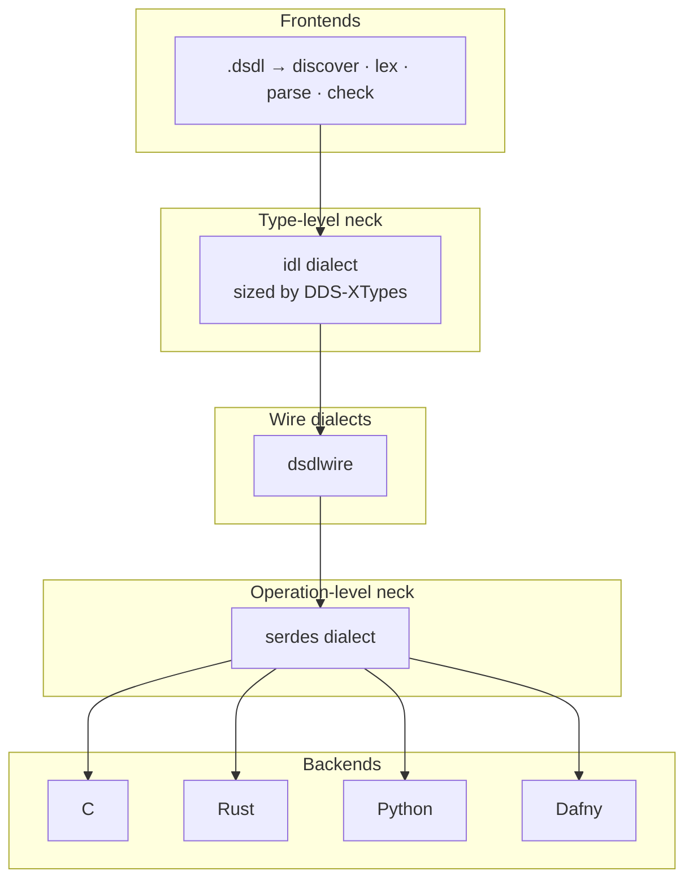

# llvm-dsdl Design

`llvm-dsdl` turns interface definitions into serialisation code. One frontend per interface
language produces one format-neutral type dialect; wire dialects lower from it; one body dialect
holds the serialisation every backend translates; and a backend is a language row, a spelling and
a renderer, held to a golden its own ecosystem defines. [RESET.md](./RESET.md) section 5 is the
full design; this page is the shape of the tree.

## What is in the tree

| Layer | Where | State |
|---|---|---|
| Frontend | `lib/Frontend`, `include/llvmdsdl/Frontend` | discovery, lexer, parser, AST printer, target resolution, depfile planning |
| Semantics | `lib/Semantics`, `include/llvmdsdl/Semantics` | constant evaluation, the BitLengthSet algebra and its exact RunSet form, the analyser |
| Support | `lib/Support`, `include/llvmdsdl/Support` | diagnostics, rationals, integer arithmetic, source locations, reserved identifiers |
| Models | `spec/dafny` | machine-checked models of the serialisation and of the bit-length algebra |
| Runtime | `runtime/dsdl_runtime.h` | the C runtime primitives |
| Tests | `test/unit` | tier 0: unit, exactness and fuzz suites |

The frontend produces an AST and, through the analyser, a semantic model of each definition with
its wire layout. Both are private to the frontend: the dialects of the design take their place as
the interface every later stage consumes.

## Rules

- Generated output takes its shape from goldens under `test/golden/`, which only the project owner
  approves ([AGENTS.md](./AGENTS.md)).
- The compiler never emits an interface language, descriptor or schema, in any format.
- IR symbols carry the DSDL identity; only a backend projects a name.
- A declined plan or an unconverted operation is an error; there is no fallback.
- Every option is one framework mechanism applied to every language by one rule.

## Build

CMake with Ninja Multi-Config against installed LLVM and MLIR packages at the locked major. The
presets in `CMakePresets.json` drive configure, build and test; `ctest` labels select tiers.
Warnings are errors, unconditionally.
