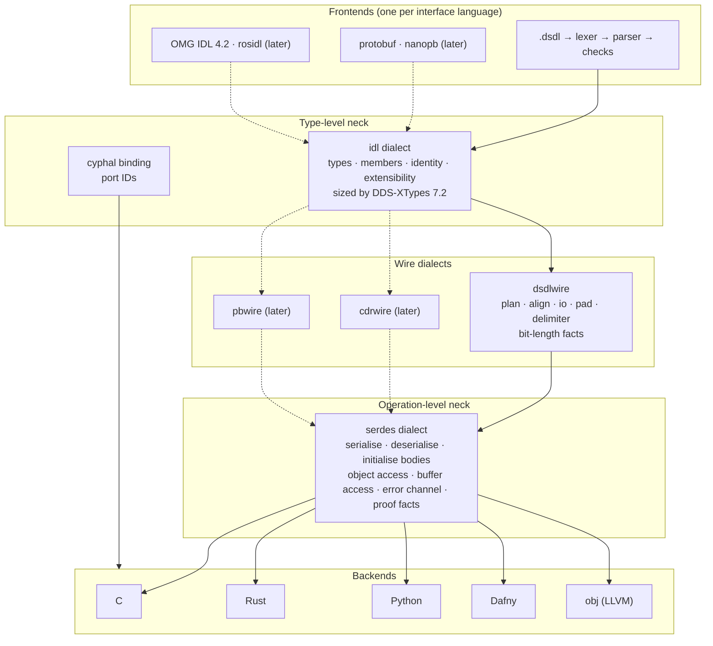
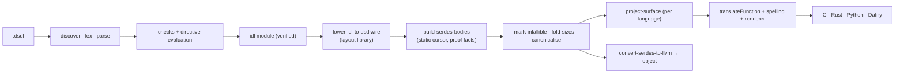
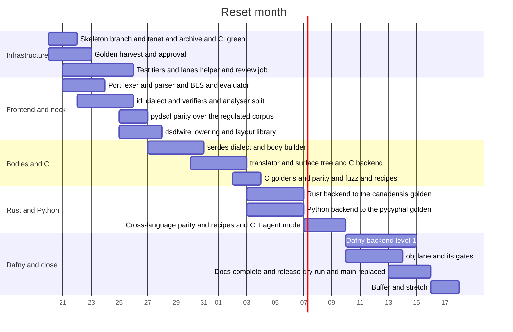

# Reset

Plan, revision 1, 2026-10-17. Written against `c0d30173` on `feature/body-shape-targets`. Nothing
in this document is implemented. It is the brief for one month of continuous agent work: one
frontier agent with subagents, eighteen hours a day, seven days a week, with review agents in CI.

## 1. Scope

The reset keeps the project's infrastructure and its frontend, deletes everything after the
frontend, and rebuilds the compiler as an hourglass: interface languages in at the top, one
format-neutral type dialect at the neck, wire dialects and serialisation bodies below it, and
language backends at the bottom. DSDL is the first and only frontend of the month. The neck is sized
by the DDS-XTypes type system so that protobuf, OMG IDL and rosidl frontends fit later without
reshaping it.

Four languages are generated at the end of the month, each to a golden its own ecosystem defines:

| Language | Golden source | Shape the output takes |
|---|---|---|
| C | Nunavut, pinned | Nunavut's C: a tree a libcanard or libudpard application compiles against unchanged |
| Rust | canadensis, pinned | canadensis's Rust: types implementing `canadensis_encoding`'s traits at the same paths |
| Python | pycyphal, pinned | Nunavut's Python target as pycyphal consumes it: a package `pycyphal.dsdl` loads unchanged |
| Dafny | hand-written, approved | Datatypes with verified serialise and deserialise; every obligation discharged by `dafny verify` |

pydsdl is the oracle for everything the frontend decides: bit-length sets, offsets, extents, port
IDs, constants, and which definitions are rejected.

The object lane (`-l obj`) stays as the forcing function that keeps the lowering real: C's API
assembled through LLVM in-process. It is scheduled in week 4 and is the first thing cut if the
month runs short (decision D6).

Out of the month, admitted by the architecture: C++, Go and TypeScript backends; `dsdld`; protobuf,
OMG IDL and rosidl frontends; memory models other than static storage; `@aliasable`, views,
accessors and zero-overhead work; the embedded `uavcan` catalogue; vocabulary bindings. Each has a
place in the design and none has code in the month.

## 2. What the tree taught

Each row is a failure the old tree paid for, the evidence, and the rule the reset builds in. The
rules are enforced by gates where a gate can express them (§7.3); the rest are review rubric
(§12.4). This table seeds `docs/development/lessons.md`, which grows for as long as the project
does.

| Lesson | Evidence | Rule in the reset |
|---|---|---|
| Output shape left to the agent converges on whatever the emitter finds easiest. | Three deliveries of fact-walking planners read as the real thing; six languages emitted C-mangled names; #133 found every language's serdes shaped like the lowering's SSA. | Shape is decided by goldens that Scott approves (§3). An agent never changes one on its own judgement. |
| Shortcuts taken for the first backend become the shape every later backend must undo. | The `dsdl` dialect was a wire-layout dialect with no type-level form; backends took the semantic model as input; C names were stamped into the IR; `Discovery` depended on the surface planner. | The neck is built before any backend, and every design step passes the generality checklist (§5.7) at review. |
| A metric that scans source text proves nothing about behaviour. | Convergence "100" was `re.search` over emitter sources; parity scorecards matched `ctest -N` names. | A gate is behavioural, written first, and shown to fail before the change that satisfies it. |
| A per-language exception is how the shared architecture decays. | Go's hand-written `AppendBinary`, a Go runtime shim, CETL named in the C++ backend. | Every option is one framework mechanism applied to every language by one rule: a column of the language row, an operation of the body dialect, or a renderer concept. |
| Test infrastructure that grows by accretion sets the cycle time. | 253 ctest entries, 1,075 CPU-seconds sequential, a 4,133-line registration file, each parity lane regenerating its corpus, lanes registered only when a toolchain is found, wall-clock gates, a label regex that put a fixture into the bench lane. | Tiered lanes with budgets, a corpus generated once and shared, unconditional registration, instruction counts in place of wall clock (§7). |
| Documentation drifts the moment it describes the tree by hand. | Twelve pages described the pre-consolidation architecture; the Dafny README cited a verifier that never existed; the README documented removed flags. | Generated where a generator exists (dialect docs from ODS, pipeline from the pass registry, options from `--help`); a name gate fails the docs build on a pass, op or flag that no longer exists (§10). |
| Assertions about what the tree does were wrong until a gate checked them. | The obj lane generated C and executed `$CC` while the design doc said direct lowering; `--optimize-lowered-serdes` was inert on five backends. | A claim about the compiler is a gate or it is not made. |
| Parallel sessions in one tree and large unreviewed deliveries made a mess nobody could read. | Three sessions fixed one defect in three emitters while a fourth deleted them; 2,110 lines in one delivery; merge commits; stacked PRs landing in dead branches. | One writer per directory, check-ins at every milestone, rebase only, stacks landed base-first and verified by tree (§12). |
| A hand-rolled CLI accumulates per-language flags. | `tools/dsdlc/main.cpp` at 2,599 lines parses `argv` by hand and carries `--rust-*`, `--py-*`, `--ts-*`, `--go-*` and `--cpp-*` families. | LLVM's option table, one language selector, language facts in the row (§8). |
| A question put to Scott in project jargon gets no answer. | "Where should an accessor's member type enter the IR?"; "the body". | A decision is asked as before-and-after generated code, in the target language, with one sentence on what differs (§12.3). |

## 3. The tenet

The following section is added to `AGENTS.md` in the reset branch's first commit, under the heading
below, and governs every agent working in the repository.

> ## Output shape is decided by goldens, never by the agent
>
> The shape of everything the compiler generates is fixed by golden files under `test/golden/`.
> A golden is produced by a pinned peer generator (Nunavut, pycyphal, canadensis, pydsdl) or
> written by hand and approved by the project owner. Generated output is held to its golden by CI.
>
> An agent does not decide what generated code looks like. It does not rename, reorder, reshape,
> simplify or improve generated output on its own judgement, and it does not change a golden to
> make a gate pass. A change to any file under `test/golden/` is proposed as a pull request whose
> description shows the before and after of the generated code; it merges only with the
> `shape-approved` label, which only the project owner applies. CI fails a pull request that
> changes a golden without the label.
>
> Where no golden exists for a question of shape, the agent writes the candidate golden by hand,
> in the target language, and asks. It does not generate first and ask afterwards.

## 4. Inventory: keep, port, delete

Counts are lines in the tree at `c0d30173`. The old tree is archived as tag `pre-reset-2026-10` and
branch `legacy/main` before anything is deleted; nothing is lost, and anything parked here is
retrieved from there when its turn comes.

### 4.1 Kept as it is, or trimmed

| Path | Lines | Disposition |
|---|---|---|
| `AGENTS.md`, `CLAUDE.md`, `LICENSE.md`, `LICENSES/`, `SECURITY.md`, `THIRD_PARTY_NOTICES.md`, `VERSION`, `project-identity.json` | | Kept. `AGENTS.md` gains §3. |
| `.clang-format`, `.clang-format-ignore`, `.clang-tidy`, `.gitignore`, `.devcontainer/`, `.vscode/` | | Kept. |
| `CMakeLists.txt` | 1,700 | Rewritten as a skeleton that keeps: the LLVM major lock, warnings as errors, static binaries, coverage, sanitizers, the docs targets, install components, SBOM, Debian packaging, man pages, the downstream CMake package, the Bazel module, CPack. Everything naming a deleted lane goes. |
| `CMakePresets.json` | | Kept; test presets renamed to the tiers of §7.1. |
| `cmake/` | 3,612 | Kept: `CheckClangFormat`, `CheckClangTidy`, `RunClangFormat`, `DistClean`, `GenerateCoverageReport`, `GenerateSBOM`, `Packaging`, `PackagingProjectConfig.cmake.in`, `llvm-dsdlConfig.cmake.in`, `DSDLCGenerate`, `BundleSelfContainedTools`, `RunPackagingDebConfigSelftest`. The `Run*` lane scripts go with their lanes. |
| `.github/` | 2,216 | Kept: every workflow and action. `provision-peer-dsdl-compiler` gains pycyphal and canadensis pins. `ci.yml` is rewritten to the tiers of §7.5 and gains the review job of §12.4. |
| `packaging/` | 2,473 | Kept whole: toolchain build, Dockerfiles, Debian, verify scripts, `rules_dsdl`. |
| `mkdocs.yml`, `docs/` | 5,474 | Skeleton kept: `index`, `start/`, `agents/`, `development/{contributing,testing,release-packaging,distribution-channels}`, assets. The reference and architecture pages are rewritten per §10. |
| `tools/` | | Kept: `docs/`, `man/`, `prepare_release.py`, `repo_identity.py`, `run_clang_tidy.py`, `check_clang_tidy_config.py`, `check_test_skips.py`, `determinism/`, `gates/typed_dialect_attributes.py`, `check_language_classification.py`, `check_emitter_ir_queries.py`, `judge_generated_code.py`, `generate_prdt_corpus.py`. Each gate tool is re-pointed at the new dialect and emitter names. |
| `spec/dafny/` | 3,328 | Kept. `CyphalSerdes.dfy` is the model the Dafny backend's proofs refine (§5.5). |
| `submodules/public_regulated_data_types` | | Kept: the corpus. `CETL` and `libudpard` are removed from `.gitmodules` (D11). |
| `examples/showroom/dsdl/lanyard` and `recipes/` | 3,158 | The namespace is kept as corpus. The recipe set is trimmed to the languages of the month (§9). |
| `runtime/dsdl_runtime.h` | | Replaced by the pinned Nunavut support header under D4; kept on the archive branch. |

### 4.2 Ported, with the decoupling each needs

| Path | Lines | What changes in the port |
|---|---|---|
| `lib/Frontend/{Lexer,Parser,ASTPrinter}.cpp`, `include/llvmdsdl/Frontend/{AST,Lexer,Parser,ASTPrinter,SourceLocation}.h` | 3,505 | As they are. The grammar conformance work (six audit rounds to zero), the fuzz harnesses and the depth bounds come with them. |
| `lib/Frontend/Discovery.cpp` | 806 | Loses its dependencies on `LanguageTraits`, `NamingPolicy` and `SurfacePlan`. It discovers, parses names, sorts, and rejects duplicate versions and case-insensitive collisions. Output-name collisions are a backend concern and move to the surface stage (§5.5). |
| `lib/Frontend/{TargetResolution,DepfilePlanner}.cpp` | 724 | As they are; they serve the CLI and build integration. |
| `lib/Semantics/{BitLengthSet,RunSet}.cpp` | 2,653 | As they are, with the header specification, the sixteen-defect log in the tests, the pydsdl differential and the Dafny models. |
| `lib/Semantics/Evaluator.cpp` | 1,168 | As it is: the symbolic `_offset_` binding is a frontend-only concern (§5.7, pitfall 2 of the study). |
| `lib/Semantics/Analyzer.cpp` | 1,525 | Split in two. `Frontend/Checks`: DSDL language rules, directive evaluation, constant evaluation, reference resolution; produces the `idl` module. `Semantics/Layout`: DSDL bit layout over the `idl` types; used by the frontend for `_offset_` and by the `dsdlwire` lowering, one implementation. `Model.h` becomes frontend-private. `AliasLayout` is parked. |
| `lib/Support/{Diagnostics,Rational,IntegerMath,SourceLocation,ReservedIdentifiers,CliPath}`, `FlatSet.h` | 1,268 | As they are. |
| `test/unit/{Lexer,Parser,Conformance,LexerFuzz,ParserFuzz,BitLengthSet,BlsExactness,Evaluator,Analyzer,FlatSet,IntegerMath}Tests.cpp`, `test/integration/BlsDifferentialTool.cpp`, `bls_pydsdl_differential.py` | 4,900 | As they are; `AnalyzerTests` is split with the analyser. |
| `lib/Transforms/BuildDSDLPlanBodies.cpp` | 2,865 | Ported by design, not by code: the static cursor, `index_holds`, first-failure exit, the union as one switch, padding as one write, counted loops with the offset from the induction variable, nested composites advanced by a constant where fixed. Rewritten against the new dialects (§5.4). |

### 4.3 Deleted

| Path | Lines | Note |
|---|---|---|
| `lib/CodeGen/` | 25,390 | Six emitters, the renderer, the surface plan, the embedded catalogue, vocabulary. |
| `lib/Transforms/` | 10,790 | Passes, conversions, surface projection, runtime emission. The design of `ConvertDSDLToLLVM` and `EmitDSDLRuntime` returns with the obj lane in week 4. |
| `lib/LSP/`, `tools/dsdld/` | 9,023 | Parked (D5). It depends on the frontend and on one lowering header; it returns on the neck in month 2. |
| `lib/IR/`, `lib/Lowering/`, `lib/SerDes/` | 1,733 | Replaced by the dialects of §5. |
| `lib/Support/{NamingPolicy,SurfacePlan,SurfaceLookup,SectionScopes,PlanSymbol,BodyNaming,BodyInterface,DefinitionNaming,GeneratedFact,ImportNameScope,LanguageTraits,NameCanonicalization,ScalarStorage,Language}` | 7,620 | The language row returns as §5.5 describes it; the rest is the old surface machinery. |
| `tools/dsdlc/` | 3,181 | Rewritten (§8). |
| `runtime/{cpp,go,ts,python,python_accel,rust}` | 4,400 | The peers' runtimes take their place (D2, D3, D4). |
| `test/integration/`, `test/lit/`, `test/benchmark/` | 61,838 | Rebuilt under §7. The DSDL fixtures under `test/lit/fixtures*` are curated into `test/corpus/` first. |
| `vocabulary/`, `examples/vocabulary/`, `examples/cyphal_yakut_register_demo/`, `examples/cyphal_ping_pong/` | 4,700 | Parked. The ping-pong example returns as a C consumer test once the C backend is golden. |
| `DESIGN.md`, `CONTRIBUTING.md`, `README.md` | | Rewritten short, diagram-led (§10). |

Of 62,275 lines under `lib/`, about 10,000 are ported and the rest deleted. Of 69,204 lines under
`test/`, about 4,900 are ported.

## 5. Architecture

Two necks. The `idl` dialect is the type-level neck: every frontend produces it and nothing else,
and every wire dialect lowers from it. The `serdes` dialect is the operation-level neck: every wire
dialect builds bodies in it, and every backend translates those bodies and nothing else. A backend
reads the `idl` module for declarations, the `serdes` bodies for behaviour, and the wire dialect
for the facts its declarations state (extent, buffer size). It never reads a frontend structure.

### 5.1 Frontend

The DSDL frontend is the ported lexer, parser and discovery, plus the language-check half of the
analyser. It produces one `idl` module per compilation, with MLIR locations pointing at the source,
and a frontend-private model for `_offset_` evaluation. The DSDL layout library it uses for
`_offset_` is the same library the `dsdlwire` lowering uses; DSDL cannot be evaluated without its
own layout, and the design contains that rather than pretends otherwise.

pydsdl is the oracle. `test/golden/pydsdl/` holds a JSON dump per definition of the regulated
corpus and the fixture corpus: resolved field types, bit-length set extrema and residues, offsets,
extent, sealed, port ID, constants with values, deprecation, and for each rejected fixture the
rejection. The frontend lane (`llvmdsdl-frontend-pydsdl`) diffs `dsdlc --emit=facts --json`
against it.

### 5.2 The `idl` dialect

The neck carries value semantics, composition, identity and extensibility, and no encoding. Its
vocabulary is the DDS-XTypes 1.3 type system (OMG formal/20-02-04, clause 7.2), which is the widest
of the interface languages in reach, read as follows.

| XTypes 1.3 concept (clause) | `idl` form | DSDL maps |
|---|---|---|
| Primitive types: boolean, byte, int8..int64, uint8..uint64, float32/64/128, char8/16 (7.2.2.2) | `!idl.bool`, `!idl.byte`, `!idl.int<lo, hi, overflow>`, `!idl.real<binary16/32/64/128>`, `!idl.char<8/16>` | `uintN`/`intN` are a range; `saturated`/`truncated` is the overflow policy; `float16` is a core extension beyond XTypes |
| String, wstring with bound (7.2.2.3) | `!idl.string<max, char>` | `utf8[<=N]` idiom |
| Array, multi-dimensional (7.2.2.4, collection types) | `!idl.array<T, dims>` | `T[N]` |
| Sequence with bound (7.2.2.4) | `!idl.seq<T, max>` | `T[<=N]`, `T[<N]` |
| Map (7.2.2.4) | `!idl.map<K, V, max>` in `idl_map` | none |
| Structure, members, single inheritance (7.2.2.4, aggregated types) | `idl.struct` with `idl.member` ops; inheritance in `idl_inherit` | composite |
| Union, discriminator, case labels, default (7.2.2.4) | `idl.union` with `idl.case` ops | `@union`, case value = position |
| Alias (7.2.2.4) | `idl.alias` | none |
| Enumeration with bit bound, bitmask (7.2.2.4) | `idl.enum<open/closed>`, `idl.bitmask` | none; constants idiom |
| Member ID, `@id`, `@autoid`, `@hashid` (7.2.2.4; annotation language 7.3.1.2) | `id` attribute, zero-based position by default, counting padding | position |
| `@optional`, `@must_understand`, `@key`, `@default`, `@external`, `@non_serialized` (7.2.2.6, 7.3.1.2) | member attributes | none |
| Try-construct behaviour DISCARD/USE_DEFAULT/TRIM (7.2.2.7) | the overflow policy on the member's type | `saturated`/`truncated` |
| Extensibility FINAL/APPENDABLE/MUTABLE (7.2.3) | `extensibility` attribute on every aggregate | `@sealed` = final; `@extent` = appendable, the extent itself is `dsdlwire` |
| `@range`, `@min`, `@max`, `@unit` (7.3.1.2) | the value domain on `!idl.int`/`!idl.real`; `unit` attribute | none |
| Type compatibility and the assignability rules (7.2.4, 7.2.4.4) | the breaking-change checker's rules, month 2 | minor-version compatibility |
| TypeIdentifier and TypeObject (7.3.4) | month 2, for the DDS binding | none |
| Extended CDR, encoding versions 1 and 2 (7.4.1, 7.4.2) | `cdrwire`, month 2 | none |

Constants are `idl.const`, services `idl.service` with request and response aggregates, versions and
deprecation attributes on the aggregate, documentation an attribute. Padding is not in the neck:
`voidN` lowers to `dsdlwire.pad` and reserves a member identity.

Three bins decide where a concept lives (study §5.1): core, which every backend honours; extension
dialects (`idl_map`, `idl_inherit`, `idl_ndarray`, `idl_unbounded`, `idl_recursive`, `idl_key`,
`idl_wide`), which a wire dialect accepts, lowers with a lossless pattern, or rejects at the source
line; and wire annotations, which live in the wire dialect. The core and the extension dialect
names are declared in week 1 with ODS verifiers, even where the month lowers none of them: the
point is that DSDL's lowering is written against the full type system, so a second frontend adds
patterns and not reshaping.

Every attribute is declared in ODS with a typed accessor and a verifier, and
`tools/gates/typed_dialect_attributes.py` fails the build on a by-name read. Symbols carry the
DSDL identity with dots (`@uavcan.node.Heartbeat.1.0`); no backend spelling enters any dialect.

### 5.3 The `dsdlwire` dialect

`dsdlwire` is the DSDL serialisation layout, lowered from `idl` by one pass that calls the shared
layout library. It holds, per aggregate section, a `dsdlwire.plan` with the facts the Specification
fixes: minimum and maximum bits, the bit-length set, extent, sealed, union tag width, and a region
of steps: `align`, `field` (width, cast mode, array length prefix width, element alignment), `pad`,
`delimiter`. It carries no helper names, no lowered-contract stamps and no target facts; those were
the old dialect's accretions and they are what made it unreadable.

### 5.4 The `serdes` dialect

`serdes` is the body vocabulary every wire dialect builds in and every backend translates. The old
`dsdl` body ops are the model for it and their design survives: object access by DSDL member name
(`load_member`, `store_member`, `element_addr`, `array_length`, `union_tag`), buffer access
(`buffer_at`, `buffer_length`, `bytes`), the error channel as an `i8` with an early exit, nested
calls by symbol, `index_holds`, and the target-neutral pointer and object types. Wire primitives
(`write_bits`, `read_bits`, `bit_write`, `bit_read`) belong to `dsdlwire`; a later `cdrwire` adds
its own.

Three rules are new, and each exists because one of the four languages needs it.

- **Construct, do not mutate.** A deserialise body computes each member as a value and materialises
  the object once, with `serdes.make_object` taking every member; a union is constructed per case.
  Dafny's datatypes are immutable, Rust's ownership prefers it, Python is indifferent, and C's
  spelling stores progressively where it likes. Decoding stops at the first failed field, as
  Nunavut does; what a failed decode leaves in a C out-object is not a contract.
- **Proof facts travel with the body.** The static cursor makes most offsets constants. Where an
  offset is a loop-carried value the builder emits the invariant that bounds it (`offset == base +
  i * elem_bits`, `offset <= buffer_bits`) and the capacity check as a precondition, as attributes
  on the loop and the entry. Dafny spells them as `invariant`, `requires` and `ensures`; the other
  three spellings ignore them. A proof fact is never derived in a backend.
- **The error channel is one shape.** Every failure is a code and an immediate exit after the
  operation that produced it. C spells the code, Rust `Result` with `?`, Python an exception at the
  public entry, Dafny `Result` with `:-`. The infallible mark (every exit constant zero) is a pass
  on the body, read by Rust and Dafny.

`index_holds`, first-failure, one switch per union, padding as one write, counted loops, and
fixed-size nested composites advanced by a constant are carried over from the old builder as
settled design (§14).

### 5.5 Backends

A backend is a row, a spelling and a renderer. The row is the language classification; its axes
are the ones Scott set out, and each axis names the framework mechanism that reads it.

| Axis | C | Rust | Python | Dafny | Mechanism that reads it |
|---|---|---|---|---|---|
| Errors | status code | `Result` | exception | `Result`/`Outcome` datatypes with `:-`; no exceptions | the error-channel spelling; infallible mark |
| Bytes | pointer and size | slice | `bytes` / `memoryview` | `seq<bv8>` (immutable value) or `array<bv8>` (heap reference) | the buffer type spelling; `buffer_length` fold |
| Scope | none below the file | modules | classes | modules, plus classes, traits and datatypes | the surface tree: where a name is declared and how it is reached |
| Null | everything can be null | nothing can be null | `None` | nothing by default; `C?` and `array?` opt in | null tests emitted only where the row admits a null |
| Integers | fixed width | fixed width, checked | unbounded | unbounded `int`; fixed widths are bitvectors or newtypes whose range the verifier must prove | storage selection from the value domain; checked arithmetic where the row says |
| Values | mutable structs | owned or borrowed | mutable objects | immutable datatypes with functional update, and mutable classes inside declared frames | construct-not-mutate bodies; the spelling of `make_object` |
| Proof | none | none | none | every index, range and loop must be proved: invariants, termination, frames | proof-fact attributes spelled or ignored |

The spelling translates `serdes` operations to text through `translateFunction`, one op at a time,
deciding no order and adding no check. The renderer places declarations through the surface tree,
which names and places every declared entity for one language and verifies its scopes; the
old `project-dsdl-surface` design is the model. Output-name collisions (`FooBar` and `Foo_bar`
meeting as a file name) are detected there, which is where the names are made.

The four shapes are fixed by goldens (§6). What that means per language:

- **C.** Nunavut's tree: `nunavut/support/serialization.h` (the pinned peer's header, vendored
  byte-identical with attribution), one header per definition with `static inline` bodies,
  Nunavut's names for types, entry points, constants, array capacities, union option tests and
  selectors, port IDs. A libcanard application built against `nnvg` output builds against `dsdlc`
  output with no change. The obj lane is the same API with the bodies assembled out of line.
- **Rust.** canadensis's shape: the module tree `canadensis_codegen_rust` writes, types implementing
  `canadensis_encoding`'s traits with its cursors, `no_std`-compatible, depending on the crate rather
  than carrying a runtime. One file per namespace rather than one file in total is a file split, not
  an API difference; the paths are identical.
- **Python.** Nunavut's Python target as pycyphal pins it: the package layout, the class API and the
  support module, so that `pycyphal.dsdl` imports the output as it imports its own.
- **Dafny.** Hand-written goldens for five shapes (a scalar message, a union, a service, a nested
  delimited composite, an array of composites) in the style of `spec/dafny/CyphalSerdes.dfy`:
  a `datatype` per section, a `Valid` predicate carrying the value domains, `Serialize` and
  `Deserialize` as verified functions over `seq<bv8>` returning `Result`. Level 1, the month's target,
  is that every generated module verifies with no `assume`, `{:axiom}` or `{:verify false}`. Level 2,
  the stretch, is a generated `lemma RoundTrip(v)` per type proved against the model in
  `CyphalSerdes.dfy`.

Adding a fifth language is a row, a spelling, a renderer layout and a golden. Nothing in the
frontend, the neck, the wire dialect or the body builder knows a language exists.

### 5.6 Transport binding

The `cyphal` attribute dialect carries the fixed port ID, its subject or service kind and the
regulated range check. It is read by the backends for the constants the goldens declare and by
nothing above them. A definition generated with and without its binding produces identical bodies;
that is the gate.

### 5.7 Generality checklist

Every design review in the month, and every pull request that touches a dialect, a pass or a
backend interface, answers these in its description. Where a gate exists the answer is the gate's
name.

1. Could a protobuf or IDL frontend produce this `idl` module without a DSDL AST? (`idl` carries no
   DSDL AST reference; the frontend-private model is not exported.)
2. Could `cdrwire` consume this without reading a `dsdlwire` fact? (No wire fact on `idl` ops.)
3. Does any backend read anything but `idl`, its wire dialect's facts and `serdes` bodies?
   (`check_emitter_ir_queries.py`, re-pointed.)
4. Is any symbol or attribute spelled for a backend? (`typed_dialect_attributes.py`; a lit test
   that greps the IR for a C, Rust, Python or Dafny identifier form.)
5. Is any policy a fallback? (A declined plan is a diagnostic; an unconverted op fails the
   conversion.)
6. Would a fifth language need anything but a row, a spelling, a layout and a golden?
   (`check_language_classification.py`: no `language ==` outside the row.)
7. Is a fact decided once? (Layout in the layout library; order in the body builder; names in the
   surface tree.)

### 5.8 Pipeline

`dsdl-opt` registers every pass and pipeline; `dsdlc --emit=idl|dsdlwire|serdes|surface` prints
each stage; the pipeline diagram in the docs is generated from the registry (§10.1).

## 6. Goldens

### 6.1 Sources and pins

| Golden | Produces | Pin | Held in |
|---|---|---|---|
| pydsdl | semantic facts per definition, rejections | `a1506ce` (1.23.0-dev), the pin in `provision-peer-dsdl-compiler` | `test/golden/pydsdl/*.json` |
| Nunavut | C tree, support header | `37095ab` (3.0.1b1), same action | `test/golden/nunavut/c/` |
| pycyphal | Python package as pycyphal generates it | the release at harvest, added to the action | `test/golden/pycyphal/py/` |
| canadensis | Rust module tree | `canadensis_codegen_rust` 0.6.3 (2026-10-06), added to the action | `test/golden/canadensis/rust/` |
| hand-written | Dafny modules | approved by Scott | `test/golden/dafny/` |
| ours | the text `dsdlc` writes | approved by Scott, `shape-approved` | `test/golden/dsdlc/<language>/` |

### 6.2 What a golden fixes

A peer golden fixes the API and the wire: generated output must compile against the consumer code
the peer's output compiles against, and must produce identical bytes for every value in the
value corpus and identical acceptance for every input in the malformed corpus where the peer
defines acceptance. A peer golden does not fix text; Nunavut's templates and a compiler need not
agree on whitespace, comment placement or helper layout.

Our own golden fixes the text. `test/golden/dsdlc/` holds `dsdlc`'s output for the fixture corpus,
diffed byte for byte on every run. It changes only under the tenet. The two together give what
the project needs: the ecosystem decides the shape, Scott decides every deviation, and the agent
decides nothing.

### 6.3 Corpus

| Corpus | Definitions | Role |
|---|---|---|
| `submodules/public_regulated_data_types/uavcan` | 189 | the regulated corpus; every tier-2 lane |
| `examples/showroom/dsdl/lanyard` | 24 | vendor-shaped types; the showroom pages |
| `test/corpus/fixtures` | curated from the 89 lit fixtures | one definition per construct and per defect class; tier 1 |
| `test/corpus/adversarial` | generated by `generate_naming_adversarial_corpus.py` | names that collide under each language's folding |
| `test/corpus/values` | generated | the value corpus: directed and seeded random values per type, as bytes written by the peer |
| `test/corpus/malformed` | generated | truncations, bad tags, bad lengths, bad delimiters, per type |

### 6.4 Harvest and approval

Day 1 of the month provisions the four peers at their pins and generates every golden over every
corpus, by one script (`tools/golden/harvest.py`) that CI can rerun to prove the goldens reproduce.
The harvest is one pull request, labelled `shape-approved` by Scott after reading the Dafny
goldens, which are the only hand-written ones. From then on the gate holds.

## 7. Testing

### 7.1 Tiers and budgets

| Tier | Runs | Holds | Budget |
|---|---|---|---|
| T0 `check-fast` | every build, locally and on every PR | unit tests, lit over the fixture corpus, dialect verifiers, the frontend-pydsdl lane on fixtures, golden text diff on fixtures | under 60 s wall after an incremental build |
| T1 `check` | every PR | T0, plus for each language over the fixture corpus: generate, compile with the peer's consumer, wire parity against the peer, malformed parity, determinism; the Dafny goldens verified | under 5 min wall at `-j16` |
| T2 `check-full` | label `full` and nightly | everything over the regulated corpus and the showroom, fuzz over every language's decoder, sanitizers, instruction-count benches, build-system recipes, the release dry run, the output oracle against the merge base | under 20 min wall per CI job |

For comparison, the tree at `c0d30173` has one tier of 253 entries at 1,075 CPU-seconds and a CI
run of 32 to 39 minutes.

### 7.2 Mechanisms

- **Generate once.** Each (corpus, language) pair is one CMake custom command whose outputs depend
  on `dsdlc` and the inputs; every lane consumes that tree. A lane never runs `dsdlc` itself.
- **One registration helper.** `llvmdsdl_add_lane(NAME TIER LANGUAGE SCRIPT ...)` in
  `cmake/Lanes.cmake` registers a test with its tier label, its toolchain requirement and its
  timeout. There is one `test/CMakeLists.txt` per tier, each under 300 lines.
- **No conditional registration.** A lane whose toolchain is absent is registered and skips with a
  reason; `check_test_skips.py` fails CI on any skip. Locally a skip is visible.
- **No wall-clock gates.** Benchmarks gate on cachegrind instruction counts and report wall clock.
- **Parallel by default.** `ctest -j` at the core count in every preset; lanes write only under
  their own `%t`.
- **Labels are tiers.** `-L t0`, `-L t1`, `-L t2` and per-language labels, no regex that can match
  two tiers.
- **Fast builds.** Development presets link the shared `libLLVM`; `sccache` where present; the unit
  test binary is one executable per library, not one for the tree.
- **Judges.** Each language's own linter runs over generated output as a T1 lane with a zero
  baseline: clang-tidy for C, clippy for Rust, ruff for Python, `dafny verify` for Dafny.

### 7.3 Gates ported from the old tree

| Gate | What it holds | Tier |
|---|---|---|
| `typed_dialect_attributes.py` | attributes read through accessors, ops matched by class | T0 |
| `check_emitter_ir_queries.py` | a backend reads no IR past the op it spells | T0 |
| `check_language_classification.py` | no `language ==` outside the row | T0 |
| `check_unordered_iteration.py` | no hashed-container iteration on the output path | T0 |
| backend contract (operation reflection, model independence, determinism) | bodies are translations of `serdes` | T1 |
| `corpus_determinism.py --matrix` | byte-identical output across runs and against the merge base | T1, T2 |
| `check_test_skips.py` | nothing silently skipped | every CI job |
| direct-lowering gates 1 to 6 | the obj lane assembles bodies, no C, no `$CC`, every entry point defined | T1, week 4 |
| `judge_generated_code.py` | linters as judges | T1 |

### 7.4 Lanes per language

| Lane | C | Rust | Python | Dafny |
|---|---|---|---|---|
| consumer compile against the golden's API | the peer's harness built against both trees, `-Werror` | `cargo check` of the peer's example against both | pycyphal loads both packages | `dafny verify` of the golden beside the output |
| wire parity against the peer | byte-equal over the value corpus | byte-equal | byte-equal | the generated `Serialize` evaluated on the value corpus through `dafny run` |
| malformed parity | acceptance-equal where the peer defines it | same | same | the generated `Deserialize` returns `Failure` on the corpus |
| fuzz | libFuzzer over the native decoder, ASan and UBSan | cargo-fuzz | atheris | none; verification stands in |
| text golden | diff | diff | diff | diff |

### 7.5 CI

Jobs run in the toolshed container on `ubuntu-26.04` and on macOS as today. Per pull request: lint,
T1 (Linux), T1 (macOS), docs build, review (§12.4), the golden-label check. On the `full` label and
nightly: T2 split by language into parallel jobs, sanitizers, fuzz, benches, recipes, release dry
run, cross-architecture determinism. The toolchain and release workflows are unchanged.

## 8. Command line

### 8.1 Three operators

| Operator | Needs |
|---|---|
| Human | grouped `--help`, diagnostics with source excerpts and colour, stable diagnostic IDs with `--explain D0012`, progress on long runs, shell completions, man pages |
| Agent | `--diagnostics=json` (every diagnostic as a record with ID, location, message, fix where one exists), `--summary=json` (inputs, outputs, timings), `dsdlc inspect <type> --json` (the facts pydsdl would report), `--emit` of every stage, deterministic output order, exit codes by class (usage, input, internal) |
| Build system | `-I`, `-o`/`--outdir`, `-MD`/`-MF`, `--list-inputs`, `--list-outputs`, `--dry-run`, `--prune-manifest`, `--generate-support`, `<root>:<path>` targets, quiet by default, nothing on stdout but what was asked for |

### 8.2 Mechanism

Options are declared in TableGen through LLVM's `OptTable`, as clang declares its own: one table
gives the parser, grouped help, the man page, and the completions. Language facts a flag used to
carry (`--rust-*`, `--py-*`) are gone; a language is selected with `-l`/`--target-language` and has
no flags of its own. Nunavut's spellings are accepted as aliases where the meaning is the same
(`-I`, `--outdir`, `--target-language`, `-Xlang`), so a build file written for `nnvg` needs the
least change. IR stages are `--emit=idl|dsdlwire|serdes|surface`, not target languages.
Diagnostics are MLIR diagnostics with locations from the frontend, rendered by one renderer in
text or JSON.

## 9. Build-system recipes

The recipe matrix is a test, as it was: each recipe builds the lanyard namespace and runs a
round-trip program, in T2. The month's set is the two idioms with one representative where that is
enough, plus the two supported integrations:

| Language | Recipes | Supported integration |
|---|---|---|
| C | `c-cmake` (the installed package and `dsdlc_generate()`), `c-make`, `c-bazel` (`rules_dsdl`) | CMake package, Bazel module |
| Rust | `rust-cargo` (build script calling `dsdlc`) | |
| Python | `py-setuptools`, `py-uv-build` | |
| Dafny | `dafny-cli` (`dafny verify` and `dafny build` over the output) | |

A workaround in a recipe is a bug report against `dsdlc`; the recipe is never the fix.

## 10. Documentation

### 10.1 Generated pages

| Page | Generator |
|---|---|
| `reference/dialects/{idl,dsdlwire,serdes,cyphal}.md` | `mlir-tblgen -gen-dialect-doc` over the ODS |
| `architecture/pipeline.md` diagram | `tools/docs/pipeline_diagram.py` from `dsdl-opt`'s pass and pipeline registry |
| `reference/commands/dsdlc-options.md` | `dsdlc --help`, as today |
| `reference/languages/<language>.md` row table | the language row, printed by `dsdlc --rows` |
| `showroom/` | the compiler's own output over the lanyard namespace, as today |
| `llms.txt`, `llms-full.txt` | as today |

### 10.2 Authored pages, one diagram each

| Page | Diagram |
|---|---|
| `README.md` | the hourglass, in one figure |
| `architecture/index.md` | the five layers and the two necks |
| `architecture/frontend.md` | text to `idl` module, and where `_offset_` is evaluated |
| `architecture/neck.md` | the three bins and the XTypes mapping table |
| `architecture/wire.md` | an `idl` struct and its `dsdlwire` plan side by side |
| `architecture/bodies.md` | a plan and its three bodies; the static cursor |
| `architecture/backends.md` | row, spelling, renderer, surface tree |
| `architecture/goldens.md` | the golden hierarchy and the approval gate |
| `development/testing.md` | the tiers |
| `development/lessons.md` | the register of §2 |
| `development/decisions/NNNN-*.md` | one page per settled decision |

### 10.3 Name gate

`tools/docs/check_names.py` reads every pass, op, dialect, flag and target name the tree declares
and fails the docs build on a page that names one that no longer exists. This is the gate against
the ghosts §2 records.

### 10.4 Decisions log

`docs/development/decisions/` holds one page per settled decision: context, decision, who decided,
date. The carried-forward decisions of §14 seed it. An agent reads it before asking anything.

## 11. Schedule

### 11.1 Milestones and gates

| Milestone | Day | Gate |
|---|---|---|
| M0 skeleton | 2 | `reset/hourglass` builds the ported frontend and its unit tests; lint, docs and release dry run green on the skeleton; `AGENTS.md` carries §3; goldens harvested and reproduced by CI; `legacy/main` and the tag exist |
| M1 neck | 7 | frontend-pydsdl lane at 189/189 and every fixture; `idl` and `dsdlwire` verify over the corpus; `dsdlc --emit` prints each stage; the CLI parses through the option table; T0 and T1 exist with budgets met; architecture pages with their diagrams; review job commenting on PRs |
| M2 C | 14 | the C consumer harness builds against `dsdlc` output; wire parity 189/189 and malformed parity against Nunavut; fuzz and sanitizer lanes green; backend contract strict; three C recipes green; text golden approved |
| M3 Rust and Python | 21 | canadensis example and pycyphal load against `dsdlc` output; wire parity for both; cross-language parity C, Rust, Python; clippy and ruff judges at zero; recipes green; `--diagnostics=json` and `inspect` |
| M4 Dafny and close | 28 | every generated Dafny module for the fixture corpus verifies under the pin; the regulated corpus verifies or each failure is a filed limitation; obj gates 1 to 6 strict; docs name gate green; release dry run produces alpha artefacts; `main` replaced (D8) |

### 11.2 Concurrency

One frontier agent orchestrates; subagents own tracks; tracks own directories; two writers never
share a file. Review agents run in CI on every pull request.

| Track | Owns | Weeks |
|---|---|---|
| A frontend and neck | `lib/Frontend`, `lib/Semantics`, `lib/IR/idl`, `lib/IR/dsdlwire` | 1 |
| B bodies | `lib/IR/serdes`, `lib/Transforms` | 2 |
| C backends | `lib/CodeGen/<language>` one subagent per language | 2 to 4 |
| D infrastructure | `cmake/`, `test/`, `.github/`, `tools/` | 1, then on call |
| E goldens and oracles | `test/golden/`, `test/corpus/`, `tools/golden/` | 1, then on call |
| F CLI | `tools/dsdlc` | 1 and 3 |
| G docs | `docs/`, root pages | throughout, one subagent |

Each track checks in at its milestone with what is done, what is left and what it decided; a track
that runs past its estimate by a day reports before continuing.

### 11.3 Effort

Thirty days at eighteen hours is 540 agent-hours of orchestration, with subagents in parallel
beneath it. The old tree reached its shape over eight calendar months and 137 pull requests; the
reset reuses its frontend, its gate tools, its infrastructure and every design decision in §14, and
builds four backends to shapes that already exist rather than inventing six. The estimate holds if
M1 lands on day 7; a slip there moves the obj lane out of the month before anything else.

## 12. Process

### 12.1 Branches

- `reset/hourglass` is the branch; `legacy/main` and tag `pre-reset-2026-10` hold the old tree.
- Work lands on the reset branch as squash-merged pull requests, one per track step, rebased and
  never merged. A stack is landed base first and verified by tree, not by the merged state.
- At M4 `main` is replaced by the reset branch (D8). Until then `main` is frozen.

### 12.2 Pull requests

A pull request carries: the generality checklist answers where it touches a dialect, pass or
backend interface; a link to the failing run of the gate it satisfies; before-and-after generated
code where output changes; `shape-approved` where a golden changes. It is under 1,000 lines of
hand-written change or it is split.

### 12.3 Questions

A question to Scott is the plain question, in generated code, with one sentence on what differs.
No project jargon. The decisions log is read first; a settled decision is applied, not re-asked,
and a gate that objects is adjusted.

### 12.4 Review agents in CI

`.github/workflows/review.yml` runs a Claude Code review on every pull request against
`.github/review/rubric.md`: the prose rules of `AGENTS.md`; the tenet; the generality checklist;
gate-first evidence; no per-language mechanism; no fallback; the lessons register. A second,
mechanical job fails the pull request when `test/golden/**` changes without `shape-approved`, when
a new pass, op or flag has no docs page, or when a lane was added without a tier. The review is
advisory on prose and blocking on the mechanical checks.

### 12.5 Memory

Lessons go in `docs/development/lessons.md`, decisions in the decisions log, and nowhere else.
Session memory is a pointer to those files, not a second copy.

## 13. Decisions for Scott

Each has a recommendation, which the plan assumes.

| | Decision | Recommendation | Alternative |
|---|---|---|---|
| D1 | What a peer golden fixes | API and wire, with our own approved text golden as the drift gate (§6.2) | text-identical to the peer, which binds the compiler to Jinja template whitespace |
| D2 | Rust shape | canadensis's: implement `canadensis_encoding`'s traits at its module paths, depend on the crate | our own runtime and traits, which no existing Rust node consumes |
| D3 | Python shape | pycyphal's: Nunavut's Python target with its support module, loadable by `pycyphal.dsdl` | our own classes, which pycyphal cannot load |
| D4 | C shape | Nunavut's, with its support header vendored byte-identical; `static inline` bodies in headers; the obj lane publishes the same headers over out-of-line symbols | our own runtime header and out-of-line `.c` bodies, which no libcanard example compiles against unchanged |
| D5 | `dsdld` | parked for the month; returns on the neck in month 2 | ported in week 1 at the cost of the Dafny backend |
| D6 | obj lane | week 4, first cut if short | out of the month |
| D7 | Dafny target | level 1 (every module verifies) over both corpora; level 2 (round-trip lemma against the model) over the fixtures as stretch | level 1 over the fixtures only |
| D8 | Landing | at M4 `main` is replaced by `reset/hourglass`; history kept under the tag and `legacy/main` | one squash pull request onto `main`, which records a 60,000-line deletion as one commit |
| D9 | CLI surface | option table, `-l` for languages, `--emit` for stages, Nunavut aliases (§8.2) | subcommands (`dsdlc build`, `dsdlc inspect`) |
| D10 | Recipes | the seven of §9 | all thirteen, five of them Python packaging back ends |
| D11 | Submodules and examples | drop CETL and libudpard from `.gitmodules`; park both C examples; ping-pong returns as a consumer test after M2 | keep them unbuilt |
| D12 | Review agent | Claude Code GitHub Action with the rubric; advisory on prose, blocking on mechanical checks | mechanical checks only |

## 14. Settled decisions carried forward

These were decided in the old tree and still bind. They seed the decisions log.

- The compiler never emits an interface language, descriptor or schema, in any format, for any
  purpose.
- IR symbols carry the DSDL identity, dots included; only a backend projects a name.
- A declined plan or an unconverted operation is an error; there is no fallback.
- Decoding stops at the first failed field.
- A union is one switch over the tag, one IR construct every backend translates.
- Array lengths are validated before anything is sized by them, through `index_holds`.
- Positional member identity is implied when not explicit, counting DSDL padding.
- Generated code carries no diagnostic suppression and no unused import.
- Wall clock is never a gate.
- A check that is necessary is in CI, label-gated where expensive, never a manual step.
- `main` is linear; branches rebase.

Decisions about helper names, wrappers, accessor signatures, C link names, the Python base class,
Go and TypeScript shapes, and every other point of output shape are superseded by the goldens.

## 15. Risks

| Risk | Signal | Response |
|---|---|---|
| The neck leaks DSDL | the `dsdlwire` lowering needs a fact `idl` does not carry, or a backend reaches for the frontend model | stop; the missing fact becomes an `idl` attribute or an extension dialect before any backend work continues |
| A peer golden cannot be met without a per-language mechanism | a spelling wants to add, remove or reorder a check | the mechanism goes in `serdes` or the row, or the deviation is proposed to Scott as a golden change |
| Dafny verification time | `dafny verify` over the regulated corpus exceeds the T2 budget | `{:isolate_assertions}` and per-module verification in parallel; failing that, level 1 over the fixtures in T1 and the corpus nightly |
| Peer defects | a parity mismatch where pydsdl or Nunavut is wrong | adjudicated against the Specification; recorded in the golden with the peer issue linked; never silently matched |
| Schedule | M1 slips past day 9 | obj lane out; Dafny level 2 out; both recorded |
| Scott's review bandwidth | goldens and shape questions queue | questions batched per milestone, each in generated code; the harvest pull request is the largest read of the month |

## 16. References

- DDS-XTypes 1.3, OMG formal/20-02-04: <https://www.omg.org/spec/DDS-XTypes/1.3/PDF>. Type system
  7.2 (model 7.2.2, extensibility 7.2.3, compatibility 7.2.4); type representation 7.3 (IDL and its
  annotation language 7.3.1, TypeIdentifier and TypeObject 7.3.4); data representation 7.4
  (encoding versions 1 and 2 in 7.4.1 and 7.4.2). The reset vendors the PDF under
  `docs/reference/specifications/` with its OMG licence notice, so the neck's design review reads
  one copy.
- The IDL hourglass design study, revision 4 (2026-09-05), whose layers, bins, concept placement
  and decisions §5 adopts.
- Nunavut at `37095ab` and pydsdl at `a1506ce`, the pins in
  `.github/actions/provision-peer-dsdl-compiler/action.yml`.
- `canadensis_codegen_rust` 0.6.3 and `canadensis_encoding`.
- pycyphal, pinned at harvest.
- Dafny 4.11.0, the `formal-model` lane's pin.
- LLVM `llvmorg-22.1.8`, `packaging/toolchain/llvm.pin`; toolshed `ts26.4.5`.
